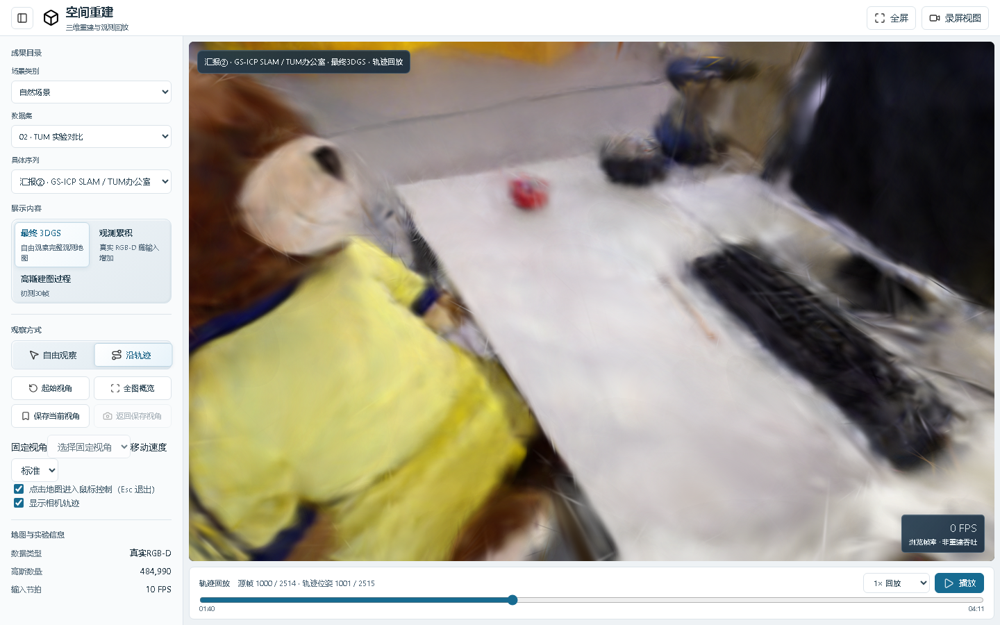
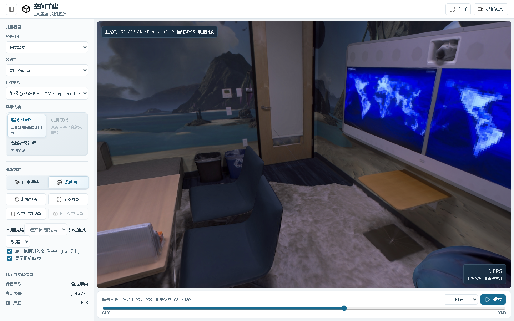
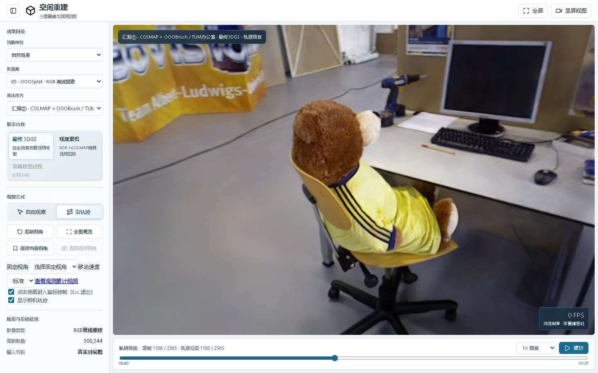
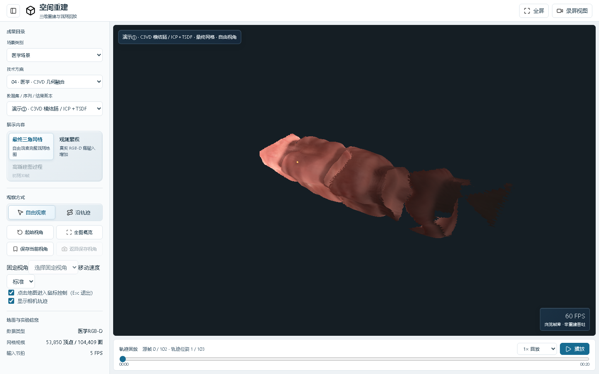
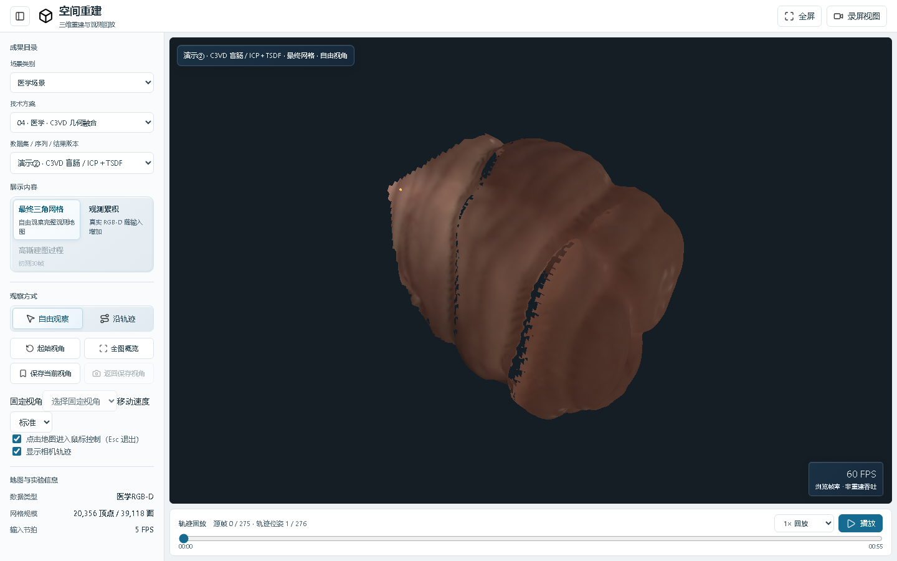
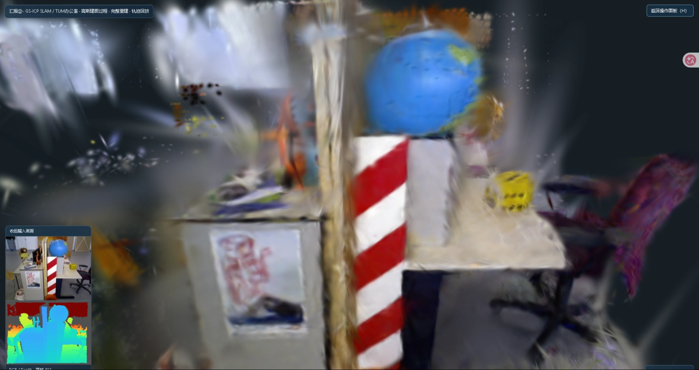
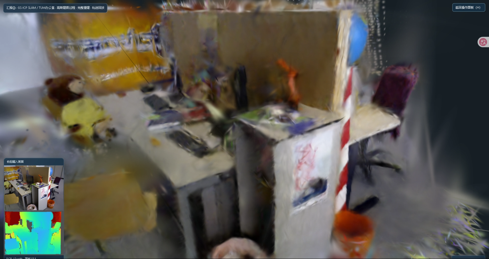

# 3DGS Reconstruction

**RGB-D 场景重建、Gaussian Splatting 渲染与 WebGL2 浏览**

项目接入 GS-ICP 与 OOOSplat 两条室内高斯重建路线，以 Open3D 里程计和 TSDF 处理 C3VD 内镜序列，并通过独立播放器查看 Flow4DGS-SLAM 动态结果。仓库提供数据准备、上游适配、场景配置和网页查看器。

---

## 🎬 视频与图片

[项目幻灯片（图片型 PDF）](https://github.com/imsquner/3dgs-reconstruction/releases/download/v0.3.0-media/3dgs-reconstruction.pdf) · [全部媒体下载](https://github.com/imsquner/3dgs-reconstruction/releases/tag/v0.3.0-media)

[](https://github.com/imsquner/3dgs-reconstruction/releases/download/v0.3.0-media/tum-online-offline.mp4)

| 场景 | 视频 |
| --- | --- |
| Replica office0 | [Replica 轨迹视角](https://github.com/imsquner/3dgs-reconstruction/releases/download/v0.3.0-media/replica-trajectory.mp4) · [Replica 全局视图](https://github.com/imsquner/3dgs-reconstruction/releases/download/v0.3.0-media/replica-overview.mp4) |
| TUM 室内 | [TUM 路径渲染](https://github.com/imsquner/3dgs-reconstruction/releases/download/v0.3.0-media/tum-trajectory.mp4) · [TUM 全局视图](https://github.com/imsquner/3dgs-reconstruction/releases/download/v0.3.0-media/tum-overview.mp4) · [TUM 高斯局部](https://github.com/imsquner/3dgs-reconstruction/releases/download/v0.3.0-media/tum-gaussian-closeup.mp4) · [TUM 在线与离线对比](https://github.com/imsquner/3dgs-reconstruction/releases/download/v0.3.0-media/tum-online-offline.mp4) |
| C3VD `trans_t2_b` | [C3VD trans_t2_b 重建过程](https://github.com/imsquner/3dgs-reconstruction/releases/download/v0.3.0-media/c3vd-trans-reconstruction.mp4) · [C3VD trans_t2_b 网格](https://github.com/imsquner/3dgs-reconstruction/releases/download/v0.3.0-media/c3vd-trans-mesh.mp4) |
| C3VD `cecum_t1_a` | [C3VD cecum_t1_a 重建过程](https://github.com/imsquner/3dgs-reconstruction/releases/download/v0.3.0-media/c3vd-cecum-reconstruction.mp4) · [C3VD cecum_t1_a 网格](https://github.com/imsquner/3dgs-reconstruction/releases/download/v0.3.0-media/c3vd-cecum-mesh.mp4) |
| 4D 动态 | [4DGS 行走片段](https://github.com/imsquner/3dgs-reconstruction/releases/download/v0.3.0-media/4dgs-walking.mp4) · [4DGS 坐姿片段](https://github.com/imsquner/3dgs-reconstruction/releases/download/v0.3.0-media/4dgs-sitting.mp4) · [4DGS 行走逐帧回放](https://github.com/imsquner/3dgs-reconstruction/releases/download/v0.3.0-media/4dgs-walking-frame-by-frame.mp4) · [4DGS 坐姿讲话](https://github.com/imsquner/3dgs-reconstruction/releases/download/v0.3.0-media/4dgs-sitting-speaking.mp4) |

<details>
<summary>展开重建截图</summary>

| Replica office0 | OOOSplat 室内重建 |
| --- | --- |
|  |  |

| C3VD trans_t2_b | C3VD cecum_t1_a |
| --- | --- |
|  |  |

| TUM 重建对比图 A | TUM 重建对比图 B |
| --- | --- |
|  |  |

</details>

---

## ✨ 特性

| 能力 | 实现 |
| --- | --- |
| RGB-D 高斯建图 | GS-ICP 处理按时间配对的 RGB 与深度帧，输出相机轨迹和高斯地图 |
| 离线高斯重建 | COLMAP 恢复相机位姿，OOOSplat / OOOBrush 生成高斯场景 |
| 医学表面重建 | Open3D RGB-D Park 里程计估计位姿，TSDF 融合后提取三角网格 |
| 动态场景回放 | Flow4DGS-SLAM 导出训练视角结果，通过独立网页按时间轴回放 |
| 浏览与复现 | WebGL2 查看器支持场景切换，下载脚本按清单校验资产 SHA-256 |

---

## 🏗 系统架构

```text
Replica / TUM RGB-D ── GS-ICP ─────────────── Gaussian PLY ──┐
TUM RGB ───────────── COLMAP + OOOBrush ───── Gaussian PLY ──┤
C3VD RGB-D ────────── Park 里程计 + TSDF ─── 三角网格 PLY ───┤
                                                             └─ 场景配置 → WebGL2 查看器
TUM fr3 动态序列 ───── Flow4DGS-SLAM ───────── 导出模型与渲染帧 → 4D 播放器
```

静态场景的路径和显示参数由场景配置管理。重建所需的上游版本和构建依赖见 [上游项目](docs/UPSTREAM.md) 与 [运行说明](docs/RUNNING.md)。

---

## 🚀 快速开始

### 1. 环境

浏览现有静态场景需要 Python 3.10+ 和支持 WebGL2 的浏览器。参照 [环境说明](docs/ENVIRONMENT.md) 配置完整重建环境。

### 2. 下载场景资产

从仓库根目录执行，脚本会下载并校验五个静态场景文件。

```powershell
python tools/download_demo_assets.py
```

### 3. 启动查看器

```powershell
python 工程/交互演示/server.py --host 127.0.0.1 --port 8765
```

浏览器访问 <http://127.0.0.1:8765/>。4D 播放器使用独立服务，需要对应的本地导出文件，配置见 [4DGS 运行说明](工程/4dgs/README.md)。

---

## 📊 重建结果

| 场景 | 输入 | 产物 |
| --- | ---: | ---: |
| Replica office0 · GS-ICP | 1,801 帧 RGB-D | 1,146,721 个高斯 |
| TUM 室内 · GS-ICP | 2,515 帧 RGB-D | 484,990 个高斯 |
| TUM 室内 · OOOSplat | 2,585 张 RGB 图像 | 500,544 个高斯 |
| C3VD `trans_t2_b` · TSDF | 103 帧 RGB-D | 53,850 个网格顶点 |
| C3VD `cecum_t1_a` · TSDF | 276 帧 RGB-D | 20,356 个网格顶点 |

这些数量描述各场景的输入和产物规模。评价口径见 [验证记录](docs/VALIDATION.md)。

---

## 📁 目录结构

```text
3dgs-reconstruction/
├── 工程/
│   ├── 交互演示/        静态查看器、场景配置和资产适配
│   ├── 4dgs/            动态场景回放
│   └── 课程扩展/        数据准备与 GS-ICP 运行脚本
├── docs/               运行、资产、数据来源和图片
├── tools/              下载、校验和复现工具
└── tests/              场景配置检查
```

## 📚 文档与数据来源

[资产清单](docs/ASSETS.md) · [数据来源与使用条款](docs/DATA_ATTRIBUTION.md) · [上游版本与许可](docs/UPSTREAM.md) · [运行说明](docs/RUNNING.md)

如有项目相关问题，欢迎邮件联系高子明（<370295@whut.edu.cn>）。
